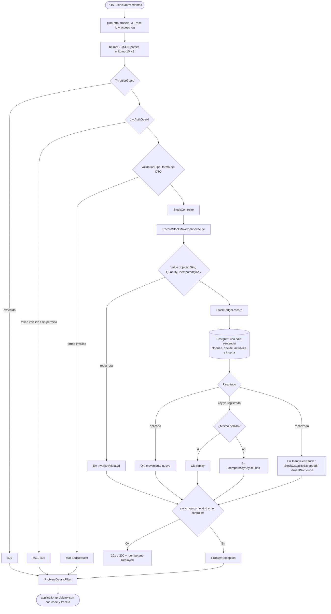

# Stock de ecommerce — `POST /stock/movimientos`

API en NestJS que registra movimientos de stock por variante y responde cuánto stock hay. El foco está en que **el stock nunca quede mal**: ni ventas de más, ni movimientos aplicados dos veces, ni saldos sin explicación.

El enunciado original está al final de este archivo.

## Índice

1. [Alcance](#alcance)
2. [Cómo correrlo](#cómo-correrlo)
3. [Cómo usar la API](#cómo-usar-la-api)
4. [Arquitectura](#arquitectura)
5. [Recorrido de un request](#recorrido-de-un-request)
6. [Manejo de errores](#manejo-de-errores)
7. [Concurrencia e idempotencia](#concurrencia-e-idempotencia)
8. [Convenciones y nombres](#convenciones-y-nombres)
9. [Tests](#tests)
10. [Decisiones y lo que quedó afuera](#decisiones-y-lo-que-quedó-afuera)

---

## Alcance

**Lo que pide el enunciado y cómo se resuelve:**
- Registrar cada cambio de stock con cuándo, cuántas unidades y por qué: `POST /stock/movimientos`.
- Que el sistema siempre pueda responder cuánto stock hay: `GET /stock/:sku`.
- Que una variante sin stock no pueda agregarse al carrito: el carrito consulta `GET /stock/:sku` antes de agregar.

**Lo que no está y por qué.** No hay carrito ni reservas. `SALE` representa una **venta confirmada**, por eso descuenta el stock en el momento. Bloquear unidades mientras el cliente decide requiere **reservas con vencimiento**, que exceden lo pedido. El modelo ya les deja lugar: el stock físico se llama `onHand` y no "disponible", porque con reservas disponible va a ser `onHand − reservado`.

**Por qué no un controller y un service.** El endpoint se podría resolver así, pero un ecommerce es, por naturaleza, concurrente y de crecimiento rápido. Lo que se buscó es una base que escale sin reescribirse:
- **Reglas del stock en el dominio:** se testean sin base ni HTTP.
- **Contratos HTTP y de persistencia separados:** cambiar uno no rompe el otro.
- **Errores tipados:** agregar un caso nuevo obliga, en compilación, a decidir qué responder.
- **Correctitud bajo concurrencia desde el día uno:** es lo más caro de agregar después.

Sumar reservas, depósitos o el kardex es agregar piezas, no reescribir las que ya existen. Ver [cómo agregar algo](#cómo-agregar-algo).

---

## Cómo correrlo

Requisitos: Node 22 (`nvm use`), Docker.

```bash
npm install
cp .env.example .env               # completar JWT_SECRET con: openssl rand -hex 32
docker compose up -d --wait        # Postgres 17 en 127.0.0.1:5432 (crea también la base de tests)
npm run migration:run
npm run seed                       # catálogo de ejemplo: zapatillas y remeras con stock
npm run start:dev                  # http://localhost:3000
```

Probarlo:

```bash
TOKEN=$(npm run -s token)          # token de desarrollo con stock:read y stock:write

curl -s localhost:3000/stock/SNK-TRAIL-42-BLK -H "Authorization: Bearer $TOKEN"

curl -s -X POST localhost:3000/stock/movimientos \
  -H "Authorization: Bearer $TOKEN" \
  -H "Idempotency-Key: $(uuidgen)" \
  -H "Content-Type: application/json" \
  -d '{"sku":"SNK-TRAIL-42-BLK","quantity":2,"reason":"SALE"}'
```

`npm run token -- <usuario> <scopes...>` genera tokens para otro usuario o con otros permisos; por ejemplo, `npm run token -- auditor stock:read` emite uno solo de lectura. El script y el seed se niegan a correr si `NODE_ENV` no es `development`.

> Si ya tenés un Postgres local en el puerto 5432, frenalo o cambiá el puerto en `docker-compose.yml` y en `.env`. El script que crea la base de tests corre solo la primera vez que se crea el volumen.

## Cómo usar la API

| Endpoint | Permiso | Respuesta |
|---|---|---|
| `POST /stock/movimientos` | `stock:write` | El movimiento registrado y el saldo resultante |
| `GET /stock/:sku` | `stock:read` | `{ "sku": "...", "onHand": 8 }` |
| `GET /health` | público | `{ "status": "ok" }` |

**Body de `POST /stock/movimientos`:** `sku` (texto), `quantity` (entero de 1 a 100000) y `reason`.

La cantidad siempre es positiva: **el sentido lo define el motivo**, no el cliente. Así nadie puede "vender" mandando una cantidad negativa.

| `reason` | Efecto |
|---|---|
| `SALE` | resta |
| `RETURN` | suma |
| `RESTOCK` | suma |
| `ADJUSTMENT_INCREASE` | suma |
| `ADJUSTMENT_DECREASE` | resta |

**Header `Idempotency-Key` (UUID, obligatorio):** si un cliente reintenta un request (por timeout, por ejemplo), el movimiento no se aplica dos veces. Ver [idempotencia](#concurrencia-e-idempotencia).

**Autenticación:** JWT HS256 en `Authorization: Bearer`, con issuer, audience y vencimiento obligatorios. El `sub` del token queda guardado como autor del movimiento.

### Respuestas

| Status | `code` | Cuándo |
|---|---|---|
| 201 | — | Movimiento registrado |
| 200 | — | Reintento de un movimiento ya registrado; incluye el header `Idempotent-Replayed: true` |
| 400 | `BadRequest` | El body o el header tienen forma inválida (tipos, campos de más); se informan todos juntos |
| 400 | `InvariantViolated` | Se rompió una regla del dominio (formato de SKU, rango de cantidad, UUID); incluye `field` |
| 401 / 403 | `Unauthorized` / `Forbidden` | Falta el token o es inválido / falta el permiso |
| 404 | `VariantNotFound` | No existe el SKU |
| 409 | `InsufficientStock` | No alcanza el stock; incluye `requested` y `available` |
| 409 | `StockCapacityExceeded` | La reposición supera el máximo que soporta la columna (2³¹−1) |
| 413 | `PayloadTooLarge` | Body de más de 10 KB |
| 422 | `IdempotencyKeyReused` | Se reusó la misma key para un pedido distinto |
| 429 | `TooManyRequests` | Se superó el rate limit |
| 503 | `ServiceUnavailable` | La base no responde; incluye `Retry-After` |
| 500 | `InternalServerError` | Error inesperado; el detalle queda solo en los logs |

Todos los errores salen como **Problem Details** ([RFC 9457](https://www.rfc-editor.org/rfc/rfc9457), `application/problem+json`), con un `code` estable para que el cliente decida sin parsear textos y un `traceId` para buscar el request en los logs.

```json
{ "type": "about:blank", "title": "Conflict", "status": 409, "code": "InsufficientStock",
  "detail": "Not enough stock for TEE-TECH-L-WHT", "requested": 1, "available": 0,
  "traceId": "e059f6e6e15a333caae720793d6cf478" }
```

---

## Arquitectura

Arquitectura **hexagonal** (puertos y adaptadores), con la regla de dependencias de **clean architecture** y **DDD táctico** en dosis chica. Cada capa responde una pregunta:

| Capa | Pregunta | Regla |
|---|---|---|
| `domain/` | ¿Qué es válido en el negocio? | TypeScript puro: sin Nest, sin base, sin HTTP |
| `application/` | ¿Qué hace el sistema? | Casos de uso; piden lo que necesitan del exterior a través de **puertos** (clases abstractas) |
| `adapters/http/` | ¿Cómo entra y sale por HTTP? | Traduce request → caso de uso → respuesta; sin lógica de negocio |
| `adapters/persistence/` | ¿Cómo se guarda? | Implementa los puertos con Postgres |

Las dependencias apuntan siempre hacia adentro: `adapters → application → domain`. Por eso el caso de uso se testea con un fake en memoria y el adaptador de Postgres se puede reemplazar sin tocar el negocio.

```
src/
  stock/
    domain/
      entities/          StockMovement, StockLevel
      value-objects/     Sku, Quantity, IdempotencyKey, StockAdjustment (validan al construirse)
      errors/            InsufficientStock, VariantNotFound, StockCapacityExceeded, IdempotencyKeyReused
      enums/ constants/  MovementReason y su dirección, límites
    application/
      use-cases/         RecordStockMovement, GetStockLevel (un archivo por acción, método execute)
      ports/             StockLedger, StockLevelReader (lo que la app necesita del exterior)
      dto/               entrada y salida de cada caso de uso
      errors/            unión de errores posibles por caso de uso
    adapters/
      http/              controller, scopes, decorators/, dto/, mappers/
      persistence/       adaptador de Postgres, SQL, orm/ (tablas)
  catalog/orm/           categorías, productos y variantes (solo tablas: el challenge no tiene casos de uso de catálogo)
  shared/                transversal: auth, logging, http (Problem Details), database, result, errors
  config/                variables de entorno validadas al arrancar
test/                    unit/ e integration/ replican la estructura de src/; fakes/, fixtures/, support/
```

**Modelo de datos:** `categories → products → variants`; cada variante tiene una fila en `stock_levels` (stock actual) y N filas en `stock_movements` (historial). El historial funciona como un **kardex**: cada movimiento guarda `balance_after`, así que cualquier saldo se puede reconstruir y auditar. La base refuerza las reglas por su cuenta con `CHECK`s (stock ≥ 0, cantidad > 0, motivo válido, formato de SKU) por si alguien la toca por fuera de la app.

### Cómo agregar algo

- **Un endpoint** (por ejemplo, `GET /stock/:sku/movimientos`): un puerto en `application/ports/`, el caso de uso en `use-cases/` con su unión de errores, la implementación en `persistence/`, y DTOs, mapper y método en `http/`.
- **Una regla de negocio** (por ejemplo, un máximo por movimiento): un value object o una validación en `domain/value-objects/` y su error en `domain/errors/`. Al sumarlo a la unión del caso de uso, **TypeScript obliga a mapearlo en el controller** (ver más abajo).

---

## Recorrido de un request



---

## Manejo de errores

Hay dos mecanismos, cada uno para una cosa distinta:

- **Errores esperados del negocio** (no hay stock, no existe el SKU, key reusada): se **devuelven** como valores, al estilo `Result` de Rust.
- **Fallas inesperadas** (se cayó la base, un bug): se **lanzan** como excepciones. El filtro global las convierte en 500/503, loguea el stack y no le muestra nada interno al cliente.

### El estilo `Result` (inspirado en Rust)

Fue una elección personal, pero tiene ventajas concretas. Un caso de uso devuelve `Ok` o `Err`, y ambos tienen un `kind` que TypeScript usa para distinguirlos:

```ts
const outcome = await this.recordStockMovement.execute(input);

switch (outcome.kind) {
  case 'Ok':
    return toStockMovementResponseDto(outcome.value.movement);
  case 'InsufficientStock':
    throw StockProblems.insufficientStock(outcome.error);
  // ...un case por cada error posible
  default:
    return exhaustiveMatchGuard(outcome);
}
```

**Lo que permite:**

- **Los errores son parte de la firma.** Leyendo el tipo de `execute()` sabés todo lo que puede salir mal; no hay `throw` escondido.
- **Exhaustividad en compilación.** `exhaustiveMatchGuard` recibe `never`: si mañana se agrega un error a la unión y nadie lo maneja, **el proyecto no compila**. Así no queda ningún error de negocio terminando, por olvido, en un 500.
- **El controller documenta el endpoint:** cada resultado posible y la respuesta HTTP que le corresponde, en un solo lugar.
- **Tests simples:** se compara un valor (`toMatchObject({ kind: 'InsufficientStock' })`) en vez de esperar excepciones.

**Lo que cuesta:** TypeScript no tiene el operador `?` de Rust, así que propagar un error implica un `switch` explícito. Preferí ese poco de repetición antes que helpers que lo escondan.

**Pensado para reutilizarse entre microservicios.** `shared/result/` (`Ok`, `Err`, `Result`, `exhaustiveMatchGuard`) no depende de nada del negocio. La idea es extraerlo a un **toolkit** versionado, un paquete npm interno que todos los servicios importen. Así cada equipo modela sus outcomes igual y un error se lee del mismo modo en cualquier servicio. Si hace falta algo nuevo, por ejemplo un helper para combinar resultados, se agrega al toolkit y se publica con un **bump de versión** (semver). Cada servicio adopta la versión nueva cuando le conviene, sin copiar código entre repos. Lo mismo aplica a `InvariantViolated` y a la conversión a Problem Details de `shared/http/`.

### Validación: una regla, un lugar

- **El DTO valida solo la forma** (tipos, presencia, campos de más). Si falla, responde 400 `BadRequest` con **todos** los campos mal juntos.
- **Los value objects validan las reglas** (formato y largo del SKU, rango de la cantidad, UUID). Si falla, responde 400 `InvariantViolated` indicando el `field`.

Cada regla existe una sola vez y el dominio nunca recibe un dato inválido, venga de HTTP, de un script o de un test.

---

## Concurrencia e idempotencia

La consigna es que el stock no puede fallar. Estas son las garantías y cómo se logran:

| Garantía | Cómo |
|---|---|
| **No se vende de más** | Una sola sentencia SQL bloquea la fila (`FOR UPDATE`), decide con ese valor, actualiza el stock e inserta el movimiento. O pasa todo o no pasa nada, sin ventanas entre leer y escribir. Además, la base tiene `CHECK (on_hand >= 0)` como red de seguridad. |
| **Un pedido se aplica una sola vez** | Restricción `UNIQUE (created_by, idempotency_key)`. Si la key ya existe, se devuelve el movimiento original (200) o `IdempotencyKeyReused` si el pedido es otro (422). |
| **Las keys de un cliente no chocan con las de otro** | La key es única **por autor** (`sub` del JWT): un cliente no puede bloquear ni leer los pedidos de otro. |
| **El error informa lo que realmente pasó** | La sentencia devuelve el stock con el que decidió, así que un 409 nunca dice "pediste 3, hay 5". |
| **El historial cierra siempre** | `stock_movements.sequence` (identity) ordena el kardex **de cada variante** por orden de aplicación; cada `balance_after` es el anterior más el movimiento. Una secuencia asigna el número al insertar, no al confirmar, pero acá el `INSERT` ocurre después de tomar el lock de la fila de stock: dos movimientos de la misma variante no pueden intercalarse. Entre variantes distintas el orden no tiene significado de negocio. |
| **Sin overflow** | Una reposición que pasaría el máximo de la columna se rechaza con 409, en lugar de un 500. |
| **Sin conexiones colgadas** | Pool con timeouts de conexión, sentencia y lock; si la base no responde, 503 con `Retry-After`. |

Todo esto se prueba con **concurrencia real contra Postgres**: 50 compradores por 10 unidades, reintentos simultáneos con la misma key y tráfico mixto de ventas y reposiciones, verificando en cada ronda que el stock final sea exactamente la suma del historial.

**Bugs reales que encontraron estos tests y se corrigieron:**

- Reintentos simultáneos con la misma key sobre la última unidad recibían 409 en vez del replay.
- Bajo contención, un 409 podía informar más stock disponible que el pedido.
- Una reposición enorme hacía overflow de la columna (500 en vez de 409).
- Sin timeouts, una base lenta colgaba el pool.
- Los logs de errores de la base incluían el SQL y sus parámetros.

Para confirmar que los tests sirven, se sacó el `FOR UPDATE` a propósito: fallan 3 tests.

---

## Convenciones y nombres

**Idioma:** el código está en inglés y la ruta en español (`/stock/movimientos`), porque la ruta la fija el enunciado.

**Nombres del dominio:**

- **`onHand` y no "available":** hoy son lo mismo, pero el día que existan reservas, *disponible* va a ser `onHand − reservado`. El nombre ya deja lugar para eso.
- **`reason` + `quantity` positiva:** el motivo explica *por qué* cambió el stock y determina el sentido.
- **`createdBy`:** quién registró el movimiento, para auditoría.
- **`balanceAfter`:** el saldo después del movimiento; es lo que hace del historial un kardex.
- **Ledger:** el registro inmutable de movimientos (`StockLedger`).

**Sufijo por rol en cada archivo** (un concepto exportado por archivo):

| Sufijo | Qué es |
|---|---|
| `.entity.ts` / `.value-object.ts` | Modelo del dominio |
| `.error.ts` / `.errors.ts` | Un error de negocio / la unión de errores de un caso de uso |
| `.use-case.ts` | Caso de uso, con un método `execute` |
| `.port.ts` / `.adapter.ts` | Interfaz que necesita la app / su implementación |
| `.orm-entity.ts` | Tabla de TypeORM (nunca sale de `persistence/`) |
| `.dto.ts` | Clase de entrada o salida (HTTP o caso de uso) |
| `.mapper.ts` | Traducción entre capas |

**Estilo:**

- Tipos explícitos y nunca `any`.
- Funciones chicas y sin comentarios: los nombres explican.
- `type` solo para uniones; `interface` para formas; DTOs como clases.
- Imports por alias (`@stock/...`, `@shared/...`); ESLint prohíbe `../`.
- Llaves en todo `if`.

Todo lo que se puede enforzar lo verifican ESLint y Prettier (`npm run lint`).

### Patrones de diseño usados

- **Ports & Adapters:** los casos de uso dependen de `StockLedger`, no de Postgres.
- **Value Object:** `Sku`, `Quantity`, `IdempotencyKey`; si existe una instancia, es válida.
- **Result / tagged union:** los errores son valores tipados con `kind`.
- **Factory method:** `make()` en errores y value objects, que valida antes de construir.
- **Mapper:** dominio → DTO de respuesta y error → Problem Details.
- **Dependency Injection** de Nest para conectar puertos con adaptadores en `stock.module.ts`.

---

## Tests

```bash
npm test                    # unitarios: dominio y casos de uso con fakes en memoria (no requiere base)
npm run test:integration    # contra Postgres real (base ecommerce_challenge_test): adaptador, HTTP end-to-end, concurrencia
npm run test:all            # todo
npm run lint && npm run typecheck
npm run migration:check     # verifica que las entidades y la migración no difieran
```

- **Sin mocks huecos:** los casos de uso se prueban con `InMemoryStockLedger`, un fake que respeta el mismo contrato que el adaptador real. Lo que depende de la base (atomicidad, locks, constraints) se prueba contra Postgres de verdad.
- **E2E por HTTP:** autenticación (token vencido, firma inválida, `alg: none`, issuer o audience equivocados), validaciones, todos los códigos de respuesta, idempotencia, rate limiting, formato de los logs y que los errores no filtren datos internos.
- **Concurrencia:** se repite varias rondas para que una carrera no pase por suerte.

---

## Decisiones y lo que quedó afuera

**Decisiones:**

- **PostgreSQL y no SQLite:** hace falta lockeo de filas y constraints serios para garantizar el stock bajo concurrencia.
- **SQL a mano en el adaptador y TypeORM para el esquema:** la operación crítica es una sentencia que hay que poder leer y razonar; el ORM se usa para migraciones y entidades.
- **Migraciones explícitas** (`synchronize` apagado) y una sola `InitialSchema`, porque todavía no hay nada desplegado.
- **Logs JSON con pino:**
  - una línea por request, con `traceId` (compatible con W3C `traceparent`), resultado de negocio, usuario y duración;
  - tokens y bodies nunca se loguean;
  - en desarrollo, salida legible y con colores.
- **Configuración validada al arrancar:** la app no levanta si falta o está mal una variable.

**Lo que dejé afuera a propósito (para no sobrediseñar):** CQRS, eventos de dominio, repositorios genéricos y capas en `catalog` mientras no tenga casos de uso.

**Si esto crece:**

- **Negocio:** stock por depósito, reservas para el carrito (disponible = físico − reservado) y endpoint de kardex.
- **Catálogo:** atributos de variante flexibles (`jsonb`) y baja lógica de productos.
- **Auth:** RS256 con JWKS (tokens emitidos por un proveedor de identidad).
- **Código compartido:** extraer `shared/result/` y Problem Details a un toolkit npm versionado, reutilizable entre microservicios.
- **Infra:** rate limit por cliente en Redis, `trust proxy` detrás de un balanceador, TLS hacia la base, OpenTelemetry y UUIDv7 para ids ordenables.

---

<details>
<summary><strong>Enunciado original</strong></summary>

### Contexto

Una plataforma de ecommerce necesita gestionar su catálogo de productos y el stock disponible. Tu tarea es implementar una parte del backend usando NestJS.

### El dominio

La plataforma vende productos organizados en categorías. Un producto tiene un nombre, una descripción, un precio y pertenece a una categoría. Un producto puede tener variantes; por ejemplo, un mismo modelo de zapatilla existe en distintos talles y colores. Cada variante es la unidad que tiene stock propio y es la que el cliente agrega al carrito.

Cuando el stock de una variante cambia, el cambio tiene que quedar registrado: cuándo ocurrió, cuántas unidades se movieron y por qué motivo (por ejemplo una compra, una devolución o un ajuste manual). El sistema siempre tiene que poder responder cuánto stock hay disponible.

Cuando un cliente intenta agregar una variante al carrito, el sistema verifica si hay stock disponible. Si no hay, no puede agregarse.

### Lo que tenés que implementar

#### `POST /stock/movimientos`

El body llega con el SKU de la variante, la cantidad y el motivo. El sistema registra el movimiento y deja el stock disponible de esa variante en un estado correcto.

Definí vos cómo modelar cantidades, qué motivos aceptás y qué pasa cuando no hay stock suficiente para una salida.

### Stack esperado

- NestJS con TypeScript estricto
- TypeORM o Prisma
- PostgreSQL o SQLite

Se espera que el código tenga responsabilidades claras y bien separadas. Cómo lo estructurás queda a tu criterio.

### Entrega

Repositorio en GitHub con un historial de commits claro y legible — que se entienda cómo fuiste construyendo la solución — y documentación que refleje cómo pensaste el problema, cómo está organizado el sistema, las decisiones de diseño que tomaste y, si aplica, cómo correr o probar tu solución más allá de lo que ya describe este README.

El formato, ubicación y nivel de detalle quedan a tu criterio. Forma parte de la evaluación.

</details>
